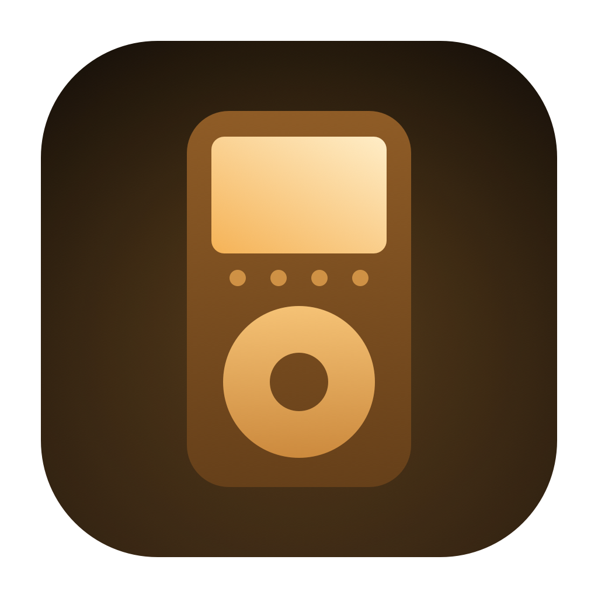

# Jonah

Get your songs back out of an old iPod, and put new ones on.

Jonah is a small native macOS app for managing the music on a classic iPod (1st to 5th generation, made with the 3rd-generation touch-wheel model in mind). Plug the iPod in, and Jonah copies chosen songs off it to your Mac with proper names in tidy folders. It can also play songs, add and delete them, clear out duplicates and edit playlists, all without iTunes.

## Download

Grab `Jonah-<version>.zip` from the [latest release](https://github.com/socialspacedev/jonah/releases/latest), unzip it, and drag **Jonah** into Applications. It runs on Apple silicon and Intel Macs with macOS 14 (Sonoma) or newer.

Jonah isn't notarised by Apple, so the first time you open it macOS says it can't check it for malware. Click **Done**, then open **System Settings ▸ Privacy & Security**, scroll down and click **Open Anyway** next to the message about Jonah. Or, in Terminal:

    xattr -dr com.apple.quarantine /Applications/Jonah.app

To skip all that, build it yourself instead (below): an app compiled on your own Mac opens straight away.

## Build from source

    ./install.sh          # build and install to /Applications
    ./build.sh            # debug build + launch
    ./build.sh release    # optimised build → dist/Jonah.app
    ./test.sh             # run the tests
    ./release.sh          # universal build, zipped for a GitHub release

## Why

Old iPods don't store songs the way you'd expect. Every track sits in a hidden `iPod_Control/Music/F00…F49` folder under a random four-letter name like `KXQZ.mp3`. The titles, artists and albums live separately, in a binary database (`iTunesDB`) that modern macOS no longer reads. Finder shows you a pile of gibberish files, and there's no built-in way to copy songs off the iPod.

Jonah reads that database directly, so you see your library as it was, and you can pick out the songs you actually want. It also writes the database the way the iPod expects, so it can manage your music now that iTunes can't.

## How it works

- **Finds the iPod by itself.** Any mounted drive with an `iPod_Control` folder is picked up, including when it's plugged in after Jonah is open. **Open Folder…** also works on a copy of an iPod's contents.
- **Lists your whole library.** Title, artist, album, track number, length and format, sortable by any column and searchable.
- **Listen first.** Click ▶ next to a song, or select it and press **P**, to play it straight off the iPod. The bar above the buttons pauses, scrubs and stops it.
- **Tick what you want.** Use the checkbox, or select rows and press **Space** (or double-click). To tick a run of songs, tick the first, then **Shift-click** the last checkbox; Shift-clicking a ticked one unticks the run. Shift-click and ⌘-click on the rows select as usual, and **Space** ticks the whole selection. The **Tick** menu ticks or unticks everything currently shown, so you can search for an artist, then tick all.
- **Exports neatly.** Songs are copied into `Artist / Album / 03 Title.mp3`. If you untick **Sort into Artist / Album folders** in the Export window, they go straight into the folder you pick as `Artist - Title.mp3`. A name that clashes gets ` 2` added, so nothing at the destination is ever overwritten.
- **Remembers what you've exported.** Exported songs get a ✓, and **Hide exported** takes them out of the list, so you can carry on where you left off.
- **Adds songs.** Click **+** or drag files or folders onto the list. MP3, AAC, WAV, AIFF and Apple Lossless go on as they are. Anything else macOS can read (FLAC, for example) is converted to 256 kbps AAC, keeping its tags. Apple Lossless needs iPod firmware 2.2 or later on a 3G.
- **Deletes songs.** Tick them, then click **Delete…**. They're removed from the iPod and from every playlist. If a song's file can't be removed (a locked iPod, say), Jonah says which.
- **Edits playlists.** Playlists are listed down the side. Click **New Playlist** (or right-click songs ▸ **Add to Playlist** ▸ **New Playlist…**), drag songs onto a playlist to add them, and drag them up and down inside it to reorder. **Remove from Playlist** (or the Delete key) takes songs out of the playlist, but leaves them on the iPod. Right-click a playlist to rename or delete it. Dropping files on the list while a playlist is showing adds them to the iPod and to that playlist. Smart playlists (⚙) were filled by iTunes' rules, so their songs can't be changed here. A song listed twice in a playlist shows once, and is kept once after an edit.
- **Finds duplicates.** **Duplicates only** shows songs with the same artist and title (ignoring case, accents and punctuation) and lengths within 3 seconds of each other, best copy first. **Tick Lesser Copies** ticks everything except the highest-bitrate copy in each group, ready to delete.
- **Keeps the iPod mounted.** Modern macOS has a device-sync agent that ejects old iPods it doesn't support, often seconds after they appear, and the iPod then shows "OK to disconnect" partway through a copy. While Jonah is open, it refuses those ejects. Use Jonah's **Eject** button, or quit Jonah, when you're done.
- **Reload** (⌘R) reads the iPod again and keeps your ticks.
- **Copes with a damaged database.** If `iTunesDB` is missing or unreadable, Jonah lists songs from the tags inside the audio files instead.

Greyed-out songs are listed in the database, but Jonah can't find their file on the iPod.

## Changing the iPod safely

Adding and deleting means rewriting the iPod's song database (`iTunesDB`). Get that wrong and the iPod shows no music, so Jonah is careful:

- **It only edits a database it fully understands.** On loading, Jonah checks that it can re-save your iPod's database byte for byte. If it can't, adding and deleting are switched off and the buttons say why. Exporting still works.
- **It backs up before every change.** The database and the files that refer to it go into `~/Library/Application Support/Jonah/Backups/`. Use **Backups ▸ Restore Song List from Backup…** to put one back. The newest 50 backups of each iPod are kept.
- **It leaves signed databases alone.** iPod classic (2007) and later sign their database, and an iPod shuffle plays from a second list (`iTunesSD`). Jonah can't update either, so on those iPods adding, deleting and playlist editing stay off.
- **It never half-writes.** The new database is written beside the old one, read back and checked, then swapped in. Deleted song files are only removed after that, so a failure partway through leaves the iPod as it was.
- **Deleting is permanent for the files.** A backup restores the song *list*, but not songs whose files were deleted. Export anything you want to keep first.

Two side effects of a delete: the iPod's recent play counts (not yet sent to iTunes) and its On-The-Go playlist are cleared, because both refer to songs by position. Both are kept in the backup.

## Which iPods

| iPod | Export and play | Add, delete, playlists |
|---|---|---|
| 1st–5th generation (scroll wheel, touch wheel, click wheel, video) | ✓ | ✓ |
| mini, nano 1st and 2nd generation | ✓ | ✓ (should work, untested) |
| classic (6th/7th generation), nano 3rd generation and later | ✓ if `iTunesDB` is present | ✗ signed database |
| shuffle | ✓ (from the files' own tags) | ✗ |
| touch, iPhone | ✗ no disk mode | ✗ |

`Jonah --check <ipod-root>` says whether a particular iPod can be changed.

## Getting an old iPod to mount

The iPod needs to show up in Finder like any other drive.

- **Cable:** the 1G and 2G models use FireWire. The 3G charges only over FireWire, though it can sync over USB with the dock-connector cable. On a modern Mac, use the right FireWire cable plus Apple's Thunderbolt adaptors.
- **Disk mode:** if the iPod doesn't appear, hold **Menu + Play/Pause** until the Apple logo shows, then straight away hold **Previous + Next** until "Do not disconnect" appears. (On click-wheel models, use **Menu + Select** to reset, then **Select + Play**.)
- **Power:** an iPod's drive can drop out as its battery dies, and Jonah then shows songs as missing. Let it charge on the cable for a while first, then click **Reload** (⌘R).
- **Permission:** the first time, macOS asks whether Jonah can access removable volumes. Allow it.

Songs bought from the iTunes Store before 2009 (`.m4p`) copy fine, but they stay DRM-locked to the Apple ID that bought them.

## Command line

The app binary also works headless, which is handy for testing or a full backup:

    Jonah --list <ipod-root>              # print every song the database knows about
    Jonah --export <ipod-root> <folder>   # copy every song (add --flat for no folders)
    Jonah --diagnose <ipod-root>          # explain why songs show as missing
    Jonah --check <ipod-root>             # can Jonah safely change this iPod?
    Jonah --dupes <ipod-root>             # list duplicate groups, best copy first
    Jonah --playlists <ipod-root>         # list playlists and their songs
    Jonah --add <ipod-root> <files…>      # add songs or folders
    Jonah --delete <ipod-root> <ids…>     # delete songs (ids from --list)
    Jonah --restore <ipod-root> <backup>  # put a backed-up song list back

For example: `.build/release/Jonah --diagnose /Volumes/MYIPOD`.

## Building

Jonah needs macOS 14 (Sonoma) or newer and the Xcode Command Line Tools (`xcode-select --install`); full Xcode isn't required. It has no third-party dependencies. `install.sh` builds on your Mac, so the app opens without any Gatekeeper warning.

`./test.sh` runs the tests (Swift Testing). They build small iTunesDBs in memory and on disk, and check round-tripping, playlist edits, deleting, backups and conversion. `test.sh` points the compiler at Swift Testing, which the Command Line Tools install but don't put on the search path.

The app icon is generated by `icon/makeicon.swift`.

## Licence

MIT © 2026 Andrew Long. See [LICENSE](LICENSE).
