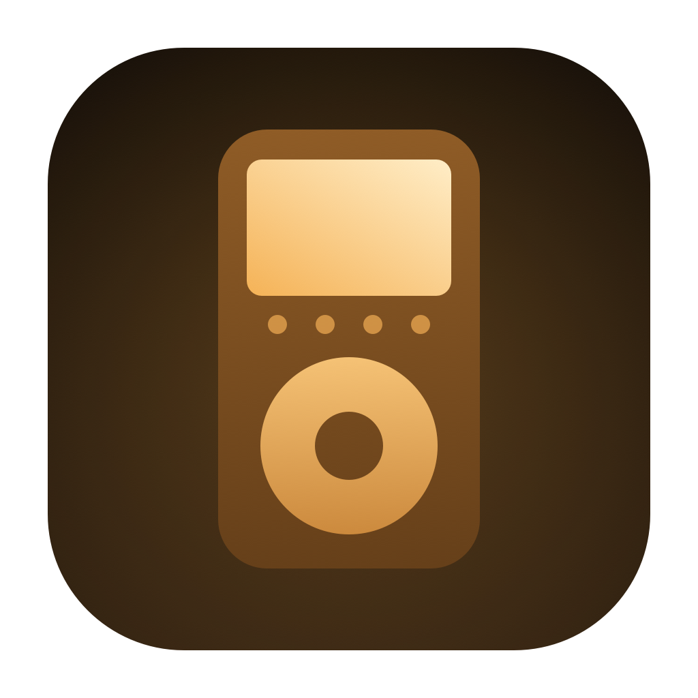

# Jonah

Get your songs back out of an old iPod.

Jonah is a small native macOS app for copying chosen songs off a classic iPod (1st to 5th generation, made with the 3rd-generation touch-wheel model in mind). Plug the iPod in, tick the songs you want, and Jonah copies them to your Mac with proper names in tidy folders.

    ./install.sh          # build and install to /Applications
    ./build.sh            # debug build + launch
    ./build.sh release    # optimised build → dist/Jonah.app

## Why

Old iPods don't store songs the way you'd expect. Every track sits in a hidden `iPod_Control/Music/F00…F49` folder under a random four-letter name like `KXQZ.mp3`. The titles, artists and albums live separately, in a binary database (`iTunesDB`) that modern macOS no longer reads. Finder shows you a pile of gibberish files, and there's no built-in way to copy songs off the iPod.

Jonah reads that database directly, so you see your library as it was, and you can pick out the songs you actually want.

## How it works

- **Finds the iPod by itself.** Any mounted drive with an `iPod_Control` folder is picked up, including when it's plugged in after Jonah is open. **Open Folder…** also works on a copy of an iPod's contents.
- **Lists your whole library.** Title, artist, album, track number, length and format, sortable by any column and searchable.
- **Tick what you want.** Use the checkbox, or select rows and press **Space** (or double-click). The **Tick** menu ticks or unticks everything currently shown, so you can search for an artist, then tick all.
- **Exports neatly.** Songs are copied into `Artist / Album / 03 Title.mp3`. A name that clashes gets ` 2` added, so nothing at the destination is ever overwritten.
- **Read-only.** Jonah never writes to the iPod.
- **Copes with a damaged database.** If `iTunesDB` is missing or unreadable, Jonah lists songs from the tags inside the audio files instead.

Greyed-out songs are listed in the database, but Jonah can't find their file on the iPod.

## Getting an old iPod to mount

The iPod needs to show up in Finder like any other drive.

- **Cable:** the 1G and 2G models use FireWire. The 3G charges only over FireWire, though it can sync over USB with the dock-connector cable. On a modern Mac, use the right FireWire cable plus Apple's Thunderbolt adaptors.
- **Disk mode:** if the iPod doesn't appear, hold **Menu + Play/Pause** until the Apple logo shows, then straight away hold **Previous + Next** until "Do not disconnect" appears. (On click-wheel models, use **Menu + Select** to reset, then **Select + Play**.)
- **Power:** an iPod's drive can drop out as its battery dies, and Jonah then shows songs as missing. Let it charge on the cable for a while first, then click **Look Again**.
- **Permission:** the first time, macOS asks whether Jonah can access removable volumes. Allow it.

Songs bought from the iTunes Store before 2009 (`.m4p`) copy fine, but they stay DRM-locked to the Apple ID that bought them.

## Command line

The app binary also works headless, which is handy for testing or a full backup:

    Jonah --list <ipod-root>              # print every song the database knows about
    Jonah --export <ipod-root> <folder>   # copy every song
    Jonah --diagnose <ipod-root>          # explain why songs show as missing

For example: `.build/release/Jonah --diagnose /Volumes/MYIPOD`.

## Building

Jonah needs macOS 14 (Sonoma) or newer and the Xcode Command Line Tools (`xcode-select --install`); full Xcode isn't required. It has no third-party dependencies. `install.sh` builds on your Mac, so the app opens without any Gatekeeper warning.

The app icon is generated by `icon/makeicon.swift`.

## Licence

MIT © 2026 Andrew Long. See [LICENSE](LICENSE).
